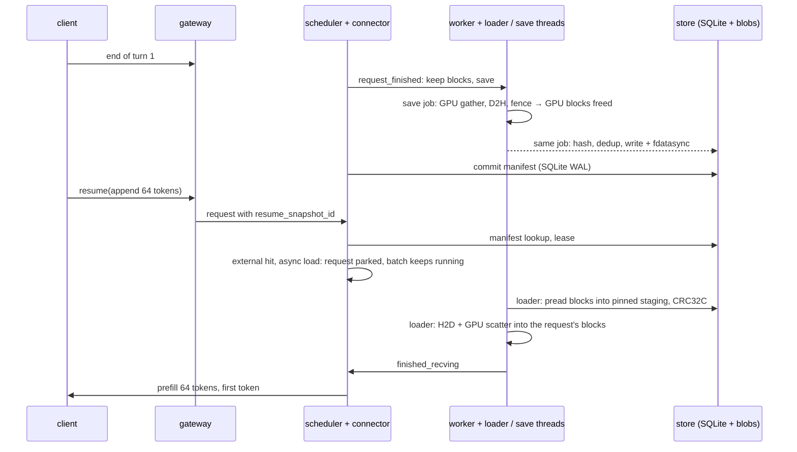

# kvsnap: session KV-cache snapshots for vLLM

Multi-turn chat pays for the whole conversation again on every turn. Once the
engine evicts a session's KV cache, the next turn re-prefills every earlier
token. This project saves a session's KV cache when a turn ends, to pinned
host memory or to disk. When the next turn arrives, it restores that cache
into freshly allocated GPU blocks, so vLLM only computes the new tokens.

It is an out-of-tree **KV connector for vLLM 0.31.0** (`KVConnectorBase_V1`)
with three parts:

- a crash-safe snapshot store: SQLite WAL metadata plus content-addressed,
  checksummed block files;
- a session gateway with turn, pause, resume and fork semantics;
- a pinned-memory data plane with a C++ copy pool.

Saves and restores move their data on worker threads beside the engine, so
running requests keep decoding while a session is restored. Not all of their
bookkeeping is off the engine step: the scheduler side matches, leases and
evicts inside it, and can wait for a commit in progress (see
[Limitations](#limitations)).

**Turn-2 time to first token, Qwen3-8B on one RTX 4090.** Turn 2 appends 64
tokens to an L-token conversation. Values are medians of 5 runs, with vLLM's
default kernels and CUDA graphs. Recompute is the same engine prefilling the
whole prompt with vLLM's prefix caching off, as in every comparison here, so
it stands for a session whose blocks were evicted, not for a prefix-cache hit:

| Context L | Recompute | Restore from host memory | Restore from disk (page cache) | Restore from disk (cold) |
|---|---|---|---|---|
| 1k | 112 ms | 39 ms (2.9×) | 70 ms (1.6×) | 114 ms (1.0×) |
| 2k | 209 ms | 51 ms (4.1×) | 94 ms (2.2×) | 185 ms (1.1×) |
| 4k | 416 ms | 72 ms (5.8×) | 138 ms (3.0×) | 316 ms (1.3×) |
| 8k | 893 ms | **119 ms (7.5×)** | **226 ms (3.9×)** | **586 ms (1.5×)** |

**While other requests are running** (Qwen3-1.7B, 16 decode streams, 8k-token
sessions resuming one every 2 s; ranges over three runs):

| Turn 2 served by | Decode gap of running requests, median / p99 | Turn-2 TTFT |
|---|---|---|
| Recompute (prefill alongside the decodes) | 48 – 49 / 240 – 261 ms | 268 – 273 ms |
| Restore, synchronous load | 9.6 – 10.2 / 89 – 120 ms | 90 – 92 ms |
| **Restore, async load (default)** | **8.8 – 9.1 / 38 – 49 ms** | 111 – 115 ms |

The recompute p99 is mostly the benchmark's own doing
([below](#interference-with-running-requests)). Outside resume windows the
gap is 8.1 – 8.7 ms median and 13 – 15 ms p99; its maximum is 31 – 41 ms in
the restore runs and 18 – 50 ms in the recompute runs. In an earlier design
that committed saves inside the engine step
([below](#where-the-turn-end-stalls-came-from)), it reached 90 – 246 ms.

## How it works

**Restore.**
1. The scheduler side reports the snapshot's tokens as an external cache hit
   and asks vLLM for an async load. vLLM allocates blocks and parks the
   request.
2. A loader thread either reads each block straight into its slot of one
   pinned buffer and CRC-checks it (disk), or borrows the worker's own pinned
   blocks (host memory).
3. The loader waits for the engine stream's queued work, copies the blocks
   to the GPU and scatters them into place.
4. vLLM then schedules the request and prefills only the suffix.

**Save.**
1. At the end of a turn the connector asks vLLM to keep the request's blocks.
2. A save job gathers them on the GPU and copies them to pinned memory. As
   soon as that copy is fenced, vLLM frees the GPU blocks.
3. The same job hashes, deduplicates and fsyncs. A commit thread on the
   scheduler side then publishes the manifest in one SQLite transaction,
   outside the engine step.

**The data path.** The copy engine is only fast with large copies, and a
snapshot touches `layers × blocks` separate 64 KiB regions. vLLM scatters
block ids in a long-running engine, and the host tier keeps one allocation
per block. So the data plane copies chunks contiguously into a device staging
buffer, then writes each layer's slice with one `index_copy_` on the GPU.
Saves are the mirror image. Measured on 1.2 GB shaped like Qwen3-8B
([`bench/h2d_patterns.py`](bench/h2d_patterns.py)):

| H2D pattern | Consecutive block ids | Shuffled block ids |
|---|---|---|
| Peak: one contiguous copy | 19.4 GB/s | |
| One `cudaMemcpy2DAsync` per (layer, run) | 17.9 GB/s | 13.0 GB/s |
| One copy per (layer, block), from per-block allocations | 13.8 GB/s | 13.8 GB/s |
| **Contiguous chunks + GPU scatter** | **17.3 GB/s** | **17.3 GB/s** |

In the restores above, the copy sustains 16.2 GB/s (1.21 GB in 75 ms, 8B at
8k).

**Failure policy.** Anything that goes wrong before a copy is issued is a
miss, and vLLM recomputes. That covers:
- a mismatched or evicted snapshot;
- a lease that can no longer be taken;
- a bad CRC.

A save that cannot be prepared, including a full pinned pool, is recorded,
and the gateway's `pause` fails at once. Only a copy whose completion cannot
be proven stops the engine. The host-memory tier is an LRU cache: a save
that does not fit evicts the least recently used unleased snapshot.

[docs/design.md](docs/design.md) covers the connector protocol, store
durability and the data plane in detail.

## Results

Reproduce everything with `scripts/bench-restore.sh` (about 15 minutes once
the models are cached). Raw output is in `results/*.json`, and
[`results/README.md`](results/README.md) lists what each file holds. The
machine also runs other services, so the same code varies by a few percent
between runs; `results/turn-end-stalls.json` holds three under-load runs of
this code and two of an earlier design.

For each sample, [`bench/restore_ttft.py`](bench/restore_ttft.py) creates a
fresh session:

1. Turn 1 prefills L random tokens.
2. `pause` saves the KV, and vLLM frees the blocks. Prefix caching is off, so
   nothing survives on the GPU.
3. Turn 2 appends 64 tokens and generates 16.

Turn 2 is then served one of four ways:
- **recompute:** the full prompt on the same engine (prefix caching off),
  sent directly, with no gateway;
- **host:** restored from a host-memory snapshot;
- **disk (warm):** restored from an on-disk snapshot that is still in the
  page cache;
- **disk (cold):** the same snapshot after `posix_fadvise(DONTNEED)`. That
  evicts the page cache only; the NVMe's own cache stays warm.

Each length gets one discarded warm-up per arm. TTFT is measured by the
client, from submitting turn 2 to its first token. Connector telemetry splits
each restore into four phases:
- admission: submit until the scheduler has allocated blocks and taken a
  lease;
- read plus CRC;
- H2D plus scatter;
- the rest: reporting the load, suffix prefill, first token.

**Qwen3-8B**
- 36 layers and 8 KV heads: 144 KiB of KV per token.
- Next to 16 GB of weights, vLLM gets 2 GiB of KV, about 14k tokens.
- `--max-num-batched-tokens 8448`, so even the 8k recompute is one prefill.

| L | Recompute (n=15) | Host | Disk (warm) | Disk (cold) | Host restore: admit / read / H2D / rest |
|---|---|---|---|---|---|
| 1k | 112 [110–115] | 39 [38–39] | 70 [69–90] | 114 [107–117] | 2.9 / 0.6 / 9.6 / 26 ms |
| 2k | 209 [208–214] | 51 [51–60] | 94 [85–101] | 185 [182–215] | 4.7 / 0.7 / 19 / 27 ms |
| 4k | 416 [415–426] | 72 [70–74] | 138 [132–140] | 316 [314–317] | 5.2 / 0.7 / 37 / 29 ms |
| 8k | 893 [882–924] | 119 [117–129] | 226 [224–237] | 586 [568–600] | 8.5 / 0.9 / 75 / 34 ms |

**Qwen3-1.7B**
- 28 layers and 8 KV heads: 112 KiB per token.
- 6 GiB of KV.

| L | Recompute (n=15) | Host | Disk (warm) | Disk (cold) | Host restore: admit / read / H2D / rest |
|---|---|---|---|---|---|
| 1k | 28 [27–29] | 21 [20–23] | 42 [40–43] | 90 [80–91] | 3.1 / 0.5 / 7.4 / 9.7 ms |
| 2k | 51 [50–52] | 40 [29–48] | 62 [60–67] | 136 [136–146] | 12 / 0.7 / 15 / 10 ms |
| 4k | 101 [100–103] | 48 [48–51] | 106 [91–121] | 250 [239–269] | 5.5 / 0.6 / 30 / 13 ms |
| 8k | 237 [220–244] | 84 [83–112] | 168 [165–185] | 471 [465–473] | 8.3 / 0.9 / 58 / 17 ms |
| 16k | 570 [551–585] | 157 [155–201] | 306 [302–402] | 907 [893–973] | 14 / 1.2 / 115 / 24 ms |

Times are in ms: median [min–max] of 5 restores. Phase columns are medians
of each phase, so they do not sum exactly to the TTFT median.

What the numbers show:

- **The win depends on compute per byte of KV.**
  - Prefilling 8k tokens takes 3.8× longer on 8B than on 1.7B (893 vs
    237 ms), but 8B has only 1.3× the KV per token.
  - On 8B, host and warm-disk restores win at every length. A cold restore
    breaks even at 1k and wins from 2k.
  - On 1.7B, a host restore wins at every length, 3.6× at 16k. A warm disk
    restore breaks even at 4k.
- **The restore is mostly H2D.**
  - H2D grows linearly with L, at 16.2 GB/s.
  - Admission takes 3–15 ms for host restores: the gateway's generation
    claim, one manifest lookup on each side and the lease. Disk restores
    take 13–30 ms; their turns fsync the generation claim.
  - The rest, 10–34 ms, is reporting the load, the suffix prefill and the
    first token.
- **A cold disk restore is limited by reads.** At 8k on 8B, reading
  1.2 GB takes 453 ms (about 2.7 GB/s) with 8 `pread`s in flight. Reads and
  copies are not overlapped yet.

### Interference with running requests

[`bench/restore_under_load.py`](bench/restore_under_load.py):
- Qwen3-1.7B;
- 16 decode streams (128-token prompts, greedy);
- six sessions with 8k-token host snapshots, resuming one every 2 s;
- `--max-num-batched-tokens 2048`.

| Turn 2 served by | Decode gap during a resume: median / p99 | Turn-2 TTFT median |
|---|---|---|
| Recompute (chunked 8k prefill in the batch) | 48 – 49 / 240 – 261 ms | 268 – 273 ms |
| Restore, load inside `start_load_kv` (sync) | 9.6 – 10.2 / 89 – 120 ms | 90 – 92 ms |
| Restore, loader thread (async) | 8.8 – 9.1 / 38 – 49 ms | 111 – 115 ms |

Ranges are over the three runs in `results/turn-end-stalls.json`
(`after`); recompute ran on both engines.

- **Recompute** puts 8k tokens of prefill into the batch and slows every
  running request: that is its median. Its p99 is mostly the benchmark
  itself. Right before submitting a recompute turn, the benchmark
  invalidates the snapshot from the event loop that also timestamps every
  stream, and in all five traced runs
  ([`results/turn-end-traces.json`](results/turn-end-traces.json)) the loop
  stalled for 212–297 ms across that call.
- **A synchronous load** stalls the whole batch for the copy.
- **The async load** leaves the median decode gap at its baseline. It
  costs the restored request one engine step to be reported, which is
  about 20 ms of TTFT.

#### Where the turn-end stalls came from

An earlier design committed saves inside the engine step. Outside resume
windows its decode gaps reached 90–246 ms, against a p99 of 14–16 ms
(`results/turn-end-stalls.json`, `before`). `restore_under_load.py
--trace-dir` records the time of every engine step over 20 ms (from the
connector), the client's event-loop stalls and garbage-collection pauses,
and the duration of each save phase. Five traced runs, from that design
through each fix in turn, are summarized in
[`results/turn-end-traces.json`](results/turn-end-traces.json) by
[`bench/trace_summary.py`](bench/trace_summary.py), which also records what
code each run used. On the 8k sessions above they show three causes:

| Stall | Cause | Fix |
|---|---|---|
| At every turn end one engine step took 71–114 ms | `commit_prepared` ran inside the engine step, 29–105 ms per save (median 62 ms): an ownership round trip for every block already committed, deep copies of a manifest that holds every token, and that manifest validated three times | A commit thread publishes saves in order; one round trip per owner; shallow copies; one validation. Commits then took a median of 19–25 ms, beside the engine |
| The client's event loop stopped for up to 197 ms, delaying every stream's tokens | Every store read took the cross-process writer lock, so the gateway's snapshot polling waited out the engine's commits; the generation claim's fsync ran on the loop | Reads take no writer lock (in WAL mode each statement sees one committed state); store calls run on worker threads |
| One 157 ms stall of every stream | A full garbage collection in the gateway process walked the vLLM client, tokenizer and model config | `gc.freeze()` once the engine is up, as vLLM does in its engine process |

Two later changes shortened admission and were not traced: host-memory
turns claim their generation without an fsync, and the engine adapter no
longer reads and parses the manifest a third time. In the last two traces,
turn ends still had up to three engine steps of 20–27 ms (see
[Limitations](#limitations)).

### Resume after an engine restart

[`bench/restart_resume.py`](bench/restart_resume.py) runs on Qwen3-8B:
1. Sessions are saved durably.
2. The engine is shut down, and a new engine starts on the same store.
   Startup takes 21 s.
3. The gateway recovers each session from its manifest and resumes it.

Two sessions per cell. Unlike the main table, the recompute here starts
right after the resumed turn, while that turn's durable save is still being
written, which may be why it is slower than the 893 ms above at 8k:

| L | Restore, page cache warm | Restore, page cache dropped | Recompute on the new engine (prefix caching off) |
|---|---|---|---|
| 2k | 96 – 98 ms | 180 – 183 ms | 210 – 216 ms |
| 8k | 242 – 245 ms | 596 – 637 ms | 970 – 1,054 ms |

A tier that lives only in host memory starts empty after a restart. That
includes this project's own volatile tier.

## Correctness and durability

- **Bit-exact restore, with a negative control.**
  - With batch-invariant kernels (`VLLM_BATCH_INVARIANT=1`), the restored
    turn's 16 logprobs equal recompute's bit for bit. This held for all 18
    restores (Qwen3-1.7B, 2k and 8k, all three tiers, CUDA graphs on).
  - The control flips the sign of one head's key vector for one token in
    each disk snapshot, with checksums fixed so the load accepts it. Then
    all 12 disk restores' logprobs differ, while 11 of 12 still produce the
    same greedy tokens. Comparing tokens alone would not have caught it.
  - With vLLM's default kernels, prefilling a 64-token suffix and prefilling
    the whole prompt are different floating-point computations. Logprobs
    then differ by up to a few nats, and greedy tokens matched in 121 of 135
    restores. vLLM's own prefix cache has the same property.
- **Crash safety.**
  - `tests/crash` SIGKILLs a real writer process at eight boundaries of a
    store commit, for both the process and durable levels: after D2H,
    during the blob write, before fdatasync, after rename, before and after
    the manifest commit, before GPU release, and during H2D.
  - `recover()` then rejects every interrupted snapshot and keeps every
    committed one.
  - These are store-level failpoints, not interrupted CUDA copies, and none
    of this tests power loss. The connector's prepare → commit path uses
    the same blob writer and publish transaction, but is not killed at its
    own points.
- **Fencing.** Each session has a generation number in SQLite. A stale
  gateway, or a late save from a superseded turn, cannot overwrite a newer
  snapshot. Restores take a lease that keeps GC and host-tier eviction away
  while the blobs are read.
- **Data plane.**
  - The C++ pool copies on its own non-blocking stream.
  - Every copy waits for the engine stream's queued work first.
  - Nothing is released until its CUDA event completes.
  - An unprovable completion keeps the memory.
  - Tests compile the pool against a fault-injecting fake CUDA runtime.

`pytest tests` runs 160 tests on CPU, covering:
- the store, crash recovery and host-tier eviction;
- the gateway;
- the connector's control flow and failure policy;
- the native data plane, against the fake CUDA runtime;
- block-layout geometry.

## Repository layout

| Path | What it is |
|---|---|
| `kvsnap/connector/vllm.py` | the vLLM KV connector: scheduler side, worker side, save and load jobs |
| `kvsnap/connector/dataplane.py` | pinned pool bindings, GPU gather/scatter, KV layout checks |
| `kvsnap/connector/volatile.py` | host-memory (pinned) snapshot tier owned by the worker |
| `kvsnap/connector/engine.py` | `AsyncLLM` adapter used by the gateway; `create_async_llm` |
| `kvsnap/store/store.py` | SQLite WAL manifests, blob files, leases, GC, eviction, fork, recovery |
| `kvsnap/gateway/` | session API: create, turn, pause, resume, fork, close (Python and HTTP) |
| `csrc/dataplane/` | C++ pinned pool (`cudaHostAlloc`, copy stream, events) and file I/O with SSE4.2 CRC32C |
| `bench/` | the benchmarks above, and `trace_summary.py` for traced runs |
| `results/` | benchmark results ([`results/README.md`](results/README.md)) |

## Limitations

- **Scope.** The connector is pinned to vLLM 0.31.0, TP=1, one full-attention
  KV group and synchronous scheduling.
- **Turn boundaries only.** A snapshot is taken at the end of a turn.
  Pausing mid-generation is not supported.
- **The bundled server is stricter than the benchmarks.**
  `kvsnap serve --engine vllm` refuses to start unless
  `VLLM_BATCH_INVARIANT=1` is set, and accepts only greedy decoding. The
  headline numbers use vLLM's default kernels: the benchmarks drive the
  engine adapter directly with that check turned off. The API takes token
  IDs only; there is no tokenizer or chat template in front of it.
- **Turn-end saves still cost the batch a little.** In the last two traced
  runs, up to three engine steps at a turn end took 20–27 ms instead of
  about 8–9 ms: the save thread's gather and D2H share the GPU with the
  decode kernels, and its hashing and bookkeeping share the GIL with the
  engine thread. A native gather that releases the GIL is next.
- **Scheduler-side bookkeeping runs inside the engine step.** Matching a
  resume, taking its lease and evicting host snapshots run on the scheduler
  thread. Each eviction, like any invalidation, is a `synchronous=FULL`
  SQLite transaction that rebuilds every blob reference count; with six
  8k-token sessions stored, the benchmark's own invalidations stalled its
  event loop for 212–297 ms. The commit thread holds the store's lock while
  it publishes, and those scheduler calls wait for it.
- **Durable saves are slow.** `pause` on an 8k-token Qwen3-8B session
  returns after about 2.3 s for a disk snapshot, against about 0.3 s for
  host memory (`save_ms` in `results/restore-qwen3-8b.json`).
- **Disk restores** read every block before the first copy. Overlapping
  reads with copies is next.
- **Saves rehash every block** to deduplicate. Unchanged blocks are not
  rewritten, but they are hashed again.
- **No head-to-head comparison** yet with vLLM's own prefix cache (every
  recompute here runs with it off), its CPU `OffloadingConnector` or
  LMCache. The last two are prefix-hash caches. This connector stores named,
  fenced session snapshots, which can be forked and recovered after a
  restart.
