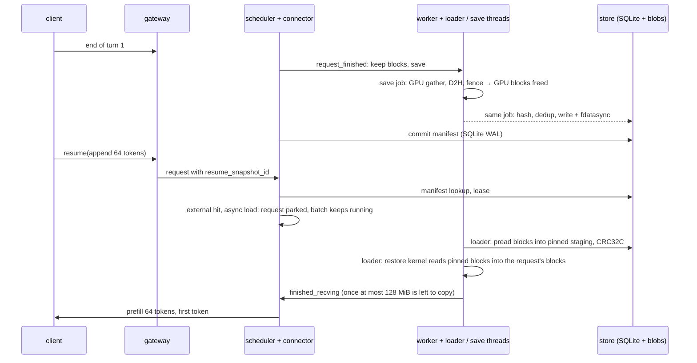
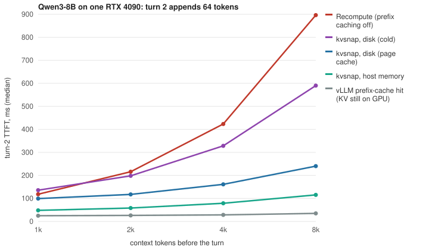

# kvsnap: session KV-cache snapshots for vLLM

kvsnap saves a chat session's KV cache as a named snapshot when a turn ends,
in pinned host memory or on disk. The next turn resumes from that snapshot,
so vLLM computes only the new tokens. Unlike vLLM's prefix cache and the
prefix-hash offloaders, a snapshot survives an engine restart, and a resume
gets exactly the saved KV or misses loudly.

**Scope:** one RTX 4090; vLLM 0.31.0 with an out-of-tree KV connector
(`KVConnectorBase_V1`; vLLM is not modified); Qwen3-8B and Qwen3-1.7B;
synthetic sessions of random tokens.

Turn 2 of an 8k-token session, median TTFT over 3 runs; bold marks the faster side:

| Setting | kvsnap | Baseline |
|---|---|---|
| Qwen3-8B, KV evicted from the GPU | **115 ms**, host memory | 897 ms, recompute |
| Qwen3-8B, after an engine restart | **212 ms**, disk (page cache warm) | 881 ms, recompute |
| Qwen3-8B, after an engine restart | **212 ms**, disk (page cache warm) | 955 ms, LMCache disk backend (recovers nothing) † |
| Qwen3-8B, four sessions rotating through GPU memory | 109 ms, host memory | **83 ms**, LMCache CPU backend |
| Qwen3-1.7B, 16 other requests decoding | 101 ms | **62 ms**, LMCache CPU backend |
| Same, p99 decode gap of the running requests during resumes, worst run | 26 ms | **19 ms**, vLLM CPU offloading |

Rows come from `results/`: `restore-qwen3-8b.json`, `restart-qwen3-8b.json`,
`restart-lmcache-disk-qwen3-8b.json`, `baseline-evicted-{kvsnap,lmcache}-qwen3-8b.json`,
and `under-load-{,lmcache-,native-offload-}qwen3-1.7b.json`. † ran at an
earlier commit; LMCache's path does not run kvsnap's load code
([`results/README.md`](results/README.md) has every file's commit).

**Limitations**
- Slower than LMCache's CPU backend from host memory (rows 4 and 5).
  LMCache pays for it under load: its p99 decode gap during resumes was
  57 – 60 ms, against 23 – 26 ms for kvsnap.
- With the KV still on the GPU, vLLM's prefix cache serves turn 2 in
  35 ms †. kvsnap runs with prefix caching off, so it has no entry for
  that case.
- With vLLM's default kernels, restores are not bit-exact: 160 of 180
  Qwen3-8B restores, and 22 of 24 after a restart, produced recompute's 16
  greedy tokens. Batch-invariant
  kernels made all 9 Qwen3-8B restores of one run bit-exact, a small sample.
- Durable saves are slow: `pause` takes about 2.2 s for an 8k-token
  Qwen3-8B disk snapshot.
- Pinned to vLLM 0.31.0, TP=1 and synchronous scheduling, on one GPU.

[How it works](#how-it-works) ·
[Design trade-offs](docs/design-tradeoffs.md) ·
[Full results](#results) ([what each file holds](results/README.md)) ·
[Reproduce](#reproduce) · [All limitations](#limitations)

## What a named snapshot buys

- **It survives an engine restart.** Disk snapshots are fdatasync'd,
  checksummed blocks behind an SQLite WAL manifest. Any tier that lives in
  host memory, including kvsnap's own, starts empty after a restart.
  LMCache's local-disk backend kept the 7.5 GB it had written, but the
  restarted engine found none of it and recomputed every token.
- **A resume gets exactly the saved KV, or misses loudly.** The snapshot is
  matched by id, model identity and tokens, not by whichever prefix blocks
  survived a shared LRU. A generation number fences a stale gateway or a
  late save from a superseded turn. A failed save fails the session's
  `pause` at once. With batch-invariant kernels, every restored turn
  tested was bit-identical to recompute. That is one run per model: 9
  restores on Qwen3-8B and 18 on Qwen3-1.7B (see
  [Correctness](#correctness-and-durability)).
- **Sessions fork.** Blocks are content-addressed, so a fork and the next
  turn share every unchanged block with their parent.

## How it works



**Restore.**
1. The scheduler side reports the snapshot's tokens as an external cache hit
   and asks vLLM for an async load. vLLM allocates blocks and parks the
   request.
2. A loader thread either reads each block straight into its slot of one
   pinned buffer and CRC-checks it (disk), or borrows the worker's own pinned
   blocks (host memory).
3. The loader waits for the work queued on the engine's stream before the
   step's forward, then launches the restore kernel, which reads each block
   from pinned memory and writes its layers straight into place.
4. Once the copy is done, or at most 128 MiB of it is left, the worker
   reports the load; vLLM
   schedules the request in the next step, whose forward waits on the GPU
   for the copy to finish, and prefills only the suffix.

**Save.**
1. At the end of a turn the connector asks vLLM to keep the request's blocks.
2. A save job gathers them on the GPU and copies them to pinned memory. As
   soon as that copy is fenced, vLLM frees the GPU blocks.
3. The same job hashes, deduplicates and fsyncs. A commit thread on the
   scheduler side then publishes the manifest in one SQLite transaction,
   outside the engine step.

**The data path.** A snapshot touches `layers × blocks` separate 64 KiB
regions, vLLM scatters block ids in a long-running engine, and the host tier
keeps one allocation per block. The copy engine is only fast with large
copies, and on this machine it tops out at 19.5 GB/s even then. So a restore
does not use it: a Triton kernel on 12 of the GPU's 128 SMs reads each
(layer, block) span from pinned memory over PCIe and writes it into place,
with no device staging and no separate scatter. Saves still gather on the
GPU into staging and copy out with large D2H copies. Measured on 1.2 GB
shaped like Qwen3-8B, median of 3 rounds
([`bench/h2d_patterns.py`](bench/h2d_patterns.py), `results/h2d-patterns.json`):

| H2D pattern | Consecutive block ids | Shuffled block ids |
|---|---|---|
| Peak DMA: one contiguous copy | 19.5 GB/s | |
| One `cudaMemcpy2DAsync` per (layer, run) | 18.2 GB/s | 13.1 GB/s |
| One copy per (layer, block), from per-block allocations | 13.8 GB/s | 13.8 GB/s |
| Contiguous DMA chunks + GPU scatter (the previous load path) | 17.5 GB/s | 17.5 GB/s |
| **Restore kernel reading pinned memory** | **22.9 GB/s** | **22.9 GB/s** |

In the restores below, with nothing else running, the copy sustains about
21 GB/s (1.21 GB in 57 ms, 8B at 8k from host memory).

**Failure policy.** Anything that goes wrong before a copy is issued is a
miss, and vLLM recomputes. That covers:
- a mismatched or evicted snapshot;
- a lease that can no longer be taken;
- a bad CRC.

A save that cannot be prepared, including a full pinned pool, is recorded,
and the gateway's `pause` fails at once. Only a copy whose completion cannot
be proven stops the engine. The host-memory tier is an LRU cache: a save
that does not fit evicts the least recently used unleased snapshot.

[docs/design.md](docs/design.md) covers the connector protocol, store
durability and the data plane in detail.

## Results

[`scripts/bench-restore.sh`](scripts/bench-restore.sh) produces every file
in `results/` (see [Reproduce](#reproduce)), and
[`results/README.md`](results/README.md) lists what each one holds. Each
timed configuration ran three times in fresh processes with different seeds;
tables give the median over all samples, with `[min–max]` where shown. The
machine ran other work at the same time (host load averages of 1.5 – 6.4
are recorded with the runs of the latest session, 5 – 9 with earlier ones).

### Every tier, one 8k-token Qwen3-8B session

Median turn-2 TTFT on one RTX 4090; 3 runs per cell; turn 2 appends 64
tokens and generates 16; vLLM's default kernels and CUDA graphs; 2 GiB of
GPU KV, about 14k tokens:

| Turn 2 served by | KV still on the GPU | KV evicted from the GPU | After an engine restart |
|---|---|---|---|
| Recompute, prefix caching off | 897 ms | 897 ms | 881 ms |
| vLLM prefix cache | **35 ms** † | 899 ms (misses) † | misses |
| vLLM CPU offloading (`--kv-offloading-size`) | | 136 ms | starts empty |
| LMCache 0.5.6, CPU backend | | **83 ms** | starts empty |
| LMCache 0.5.6, CPU and local-disk backends | | | 955 ms (finds nothing) † |

† Ran at an earlier commit than the other cells.
| kvsnap, host memory | | 109 ms | starts empty |
| kvsnap, disk, page cache warm | | 240 ms | **212 ms** |
| kvsnap, disk, page cache dropped | | 590 ms | 559 ms |

Where each column comes from:
- Resident: `results/baseline-resident-prefix-cache-qwen3-8b.json`.
- Evicted, the three CPU tiers and the prefix cache's miss: four 8k
  sessions rotating through GPU memory, 36 turns each
  (`results/baseline-evicted-*-qwen3-8b.json`).
- Evicted, recompute and kvsnap's disk tiers: `results/restore-qwen3-8b.json`,
  where nothing stays on the GPU. kvsnap's host tier measured 115 ms there.
- Restart: `results/restart-qwen3-8b.json`, and LMCache's disk row
  `results/restart-lmcache-disk-qwen3-8b.json`.

kvsnap runs with prefix caching off, so it has no entry for a KV that is
still resident. Every recompute here also runs with prefix caching off.

The cells marked † ran on an earlier version of kvsnap's load path, which
they do not use. Every other cell ran on the current one.
[`results/README.md`](results/README.md) has the commits.

**These restores are not bit-exact.** With the default kernels used above,
160 of the 180 Qwen3-8B restores in `results/restore-qwen3-8b.json` produced
recompute's 16 greedy tokens. Their logprobs differed from recompute's by up
to 3.5 nats (see [Correctness](#correctness-and-durability)). With
batch-invariant kernels (`VLLM_BATCH_INVARIANT=1`), all 9 Qwen3-8B restores
at 8k in one run (n=9, three per tier) matched recompute's tokens and
logprobs bit for bit.
They took 105 ms from host memory, 213 ms from a warm disk and 568 ms from a
cold one, against 906 ms to recompute (`results/exact-qwen3-8b.json`).

### Restore against recompute

For each sample, [`bench/restore_ttft.py`](bench/restore_ttft.py) creates a
fresh session:

1. Turn 1 prefills L random tokens.
2. `pause` saves the KV, and vLLM frees the blocks. Prefix caching is off, so
   nothing survives on the GPU: this is a session whose blocks were evicted.
3. Turn 2 appends 64 tokens and generates 16.

Turn 2 is then served one of four ways:
- **recompute:** the full prompt on the same engine, sent directly, with no
  gateway;
- **host:** restored from a host-memory snapshot;
- **disk (warm):** restored from an on-disk snapshot that is still in the
  page cache;
- **disk (cold):** the same snapshot after `posix_fadvise(DONTNEED)`. That
  evicts the page cache only; the NVMe's own cache stays warm.

Each length gets one discarded warm-up per arm. TTFT is measured by the
client, from submitting turn 2 to its first token. Connector telemetry splits
each restore into four phases:
- admission: submit until the scheduler has allocated blocks and taken a
  lease;
- read plus CRC;
- the restore kernel's copy;
- the rest: reporting the load, suffix prefill, first token.

**Qwen3-8B**
- 36 layers and 8 KV heads: 144 KiB of KV per token.
- Next to 16 GB of weights, vLLM gets 2 GiB of KV, about 14k tokens.
- `--max-num-batched-tokens 8448`, so even the 8k recompute is one prefill.

| L | Recompute (n=45) | Host | Disk (warm) | Disk (cold) | Host restore: admit / read / H2D / rest |
|---|---|---|---|---|---|
| 1k | 118 [112–121] | 48 [32–50] | 99 [64–114] | 136 [107–145] | 9.3 / 2.1 / 10 / 26 ms |
| 2k | 216 [210–218] | 58 [41–87] | 117 [81–138] | 198 [172–208] | 11 / 2.3 / 18 / 26 ms |
| 4k | 423 [416–428] | 79 [57–111] | 161 [120–235] | 328 [306–352] | 16 / 2.1 / 31 / 28 ms |
| 8k | 897 [883–906] | 115 [90–136] | 240 [197–269] | 590 [543–644] | 24 / 1.7 / 57 / 31 ms |

**Qwen3-1.7B**
- 28 layers and 8 KV heads: 112 KiB per token.
- 6 GiB of KV.

| L | Recompute (n=45) | Host | Disk (warm) | Disk (cold) | Host restore: admit / read / H2D / rest |
|---|---|---|---|---|---|
| 1k | 34 [27–36] | 25 [15–68] | 72 [37–93] | 108 [77–120] | 7.3 / 1.6 / 6.8 / 7.5 ms |
| 2k | 58 [51–64] | 37 [31–76] | 103 [53–144] | 166 [128–182] | 11 / 2.2 / 14 / 8.7 ms |
| 4k | 109 [101–130] | 51 [35–96] | 136 [81–181] | 280 [253–298] | 16 / 1.6 / 24 / 9.7 ms |
| 8k | 235 [223–248] | 80 [61–132] | 197 [147–239] | 488 [457–520] | 22 / 1.4 / 43 / 13 ms |
| 16k | 572 [555–588] | 142 [118–179] | 331 [286–477] | 940 [884–965] | 36 / 1.3 / 83 / 20 ms |

Times are in ms: median [min–max] of 15 restores (5 per run). Phase columns
are medians of each phase, so they do not sum exactly to the TTFT median.
Runs varied more than in earlier sessions: each run's median stayed within
6% of the pooled one in 20 of the 36 cells, and differed by up to 23% in the
rest, mostly short disk and host restores; `ttft_ms_median_by_run` has them
all. Host load averages of 1.7 – 5.9 are recorded with these runs.



What the numbers show:

- **The win depends on compute per byte of KV.**
  - Prefilling 8k tokens takes 3.8× longer on 8B than on 1.7B (897 vs
    235 ms), but 8B has only 1.3× the KV per token.
  - On 8B, host and warm-disk restores win at every length. A cold restore
    loses at 1k and wins from 2k.
  - On 1.7B, a host restore wins at every length, 4.0× at 16k. A warm disk
    restore still loses at 4k and wins from 8k.
- **The restore is mostly the copy.**
  - It grows linearly with L, at about 21 GB/s from host memory: 57 ms for
    8k on 8B, against 73 ms with the DMA-and-scatter path it replaced
    (`results/h2d-patterns.json` compares the two on one buffer: 22.9 against
    17.5 GB/s).
  - Admission, the gateway's generation claim, the scheduler's manifest
    lookup and the lease, took 7 – 36 ms for host restores in this session
    and 25 – 56 ms for disk restores, whose turns fsync the claim, against
    3 – 17 and 14 – 35 ms in earlier sessions on the same lookups. So the faster
    copy barely shows in the host restores' totals here (8B, 8k: 115 ms
    against 118 ms before) and short restores came out slower (8B, 1k:
    48 against 39 ms).
  - The rest, 7 – 32 ms, is reporting the load, the suffix prefill and the
    first token.
- **A cold disk restore is limited by reads.** At 8k on 8B, reading
  1.2 GB takes 480 ms (about 2.5 GB/s) with 8 `pread`s in flight. Reads and
  copies are not overlapped.
- **Saving is slower than restoring.** `pause` returns once the snapshot is
  committed: 2.1 – 2.2 s for a durable 8k snapshot on 8B, 0.29 s for host
  memory (`save_ms`).

### Against prefix caching and other offloaders

[`bench/resume_baselines.py`](bench/resume_baselines.py) serves the resumed
turn on otherwise identical Qwen3-8B engines (2 GiB of GPU KV, synchronous
scheduling, default kernels):

- **Resident:** turn 2 follows turn 1 at once, so with prefix caching on its
  KV is still on the GPU. vLLM reports all of turn 1's prompt tokens as
  cached.
- **Evicted:** four 8k-token sessions (33k tokens of KV) take turn 1 in
  order, then three more turns each in the same order, so each session comes
  back after the others pushed its blocks out. vLLM's CPU offloading and
  LMCache each get 8 GiB of CPU memory, enough for all four sessions;
  kvsnap's host tier gets 6 GiB.

| L | Prefix cache, resident † | Recompute |
|---|---|---|
| 1k | 25 [24–26] | 118 |
| 2k | 26 [26–27] | 216 |
| 4k | 29 [28–30] | 423 |
| 8k | 35 [34–39] | 897 |

| Evicted, 8k, n=36 | TTFT | Prompt tokens vLLM did not recompute |
|---|---|---|
| vLLM prefix cache alone † | 899 [888–908] | 0 of 8337 |
| vLLM CPU offloading | 136 [105–193] | 8256 |
| LMCache, CPU backend | **83** [71–90] | 8192 |
| kvsnap, host memory | 109 [92–154] | (restored by kvsnap) |

† Ran at an earlier commit, in an earlier session.

The three CPU tiers ran in one session, interleaved run by run; the
prefix cache alone ran earlier, and recompute comes from the restore runs
above.

LMCache needs its own environment: version 0.5.6 pins older numpy, protobuf
and OpenTelemetry than a plain vLLM 0.31.0 install picks, and
`scripts/install.sh lmcache` resolves them together. Neither offloader keeps
its CPU copy across an engine restart, and LMCache finds none of its disk
backend's files after one (see
[Resume after an engine restart](#resume-after-an-engine-restart)).

### Interference with running requests

[`bench/restore_under_load.py`](bench/restore_under_load.py):
- Qwen3-1.7B;
- 16 decode streams, each running 1,000-token greedy requests back to back
  (128-token prompts);
- six sessions with 8k-token host snapshots, resuming round robin, one
  every 2 s, until 54 resumes are measured (one more is a discarded
  warm-up);
- `--max-num-batched-tokens 2048`.

| Turn 2 served by | Decode gap during a resume: p50 / p99 | Turn-2 TTFT: median / p99 / max |
|---|---|---|
| Recompute (chunked 8k prefill in the batch) | 47.1 – 50.0 / 72 – 73 ms | 277 – 281 / 305 – 306 / 307 – 311 ms |
| Restore, load inside `start_load_kv` (sync) | 9.3 – 9.5 / 78 – 129 ms | 90 / 144 / 153 ms |
| Restore, loader thread (async) | 8.3 – 8.6 / 23 – 26 ms | 101 / 156 / 156 ms |
| vLLM CPU offloading (`--engines native-offload`) | 7.7 – 9.0 / 17 – 19 ms | 105 / 129 / 132 ms |
| LMCache, CPU backend (`--engines lmcache`) | 9.4 – 9.7 / 57 – 60 ms | 62 / 76 / 76 ms |

Decode-gap ranges are over the three runs (each has 2,900 – 11,000 gaps
during resumes). TTFT pools the 162 resumes of each arm; recompute ran on
both kvsnap engines. The three engines ran in one session, one run of each
in turn. The offloader arms run one engine without kvsnap, with prefix
caching and that offloader on (14 GiB of CPU memory), and send each turn's
whole prompt to it. On every resume vLLM computed none of the session's
8,192 tokens (`num_cached_tokens` is at least 8192).

Outside resume windows, the gap is about the same on every engine:

| Engine | Gap outside resumes, p50 / p99 | File |
|---|---|---|
| kvsnap | 7.5 – 8.6 / 11 – 13 ms | `results/under-load-qwen3-1.7b.json` |
| vLLM CPU offloading | 7.0 – 8.7 / 10 – 12 ms | `results/under-load-native-offload-qwen3-1.7b.json` |
| LMCache | 8.5 – 8.6 / 11 – 12 ms | `results/under-load-lmcache-qwen3-1.7b.json` |

- **Recompute** sends the whole prompt straight to the engine and puts 8k
  tokens of prefill into the batch, which slows every running request.
- **A synchronous load** stalls the whole batch for the copy: that is its
  tail.
- **The async load** costs the restored request about one engine step: its
  TTFT median is 11 ms above the synchronous load's. During resumes its
  median decode gap is 0.1 – 0.8 ms above the gap outside them in each run:
  the restore kernel shares the GPU's SMs with the batch.
- **LMCache resumes fastest** (62 ms median, 39 ms sooner than the async
  load), but its p99 decode gap during resumes is 57 – 60 ms, against
  23 – 26 ms for the async load and 78 – 129 ms for the synchronous one.
  It loads inside the step that schedules the request, as kvsnap's
  synchronous load does, and still reaches the first token 28 ms sooner
  than that load.
- **vLLM's CPU offloading** keeps the lowest p99 gap, 17 – 19 ms, and the
  lowest TTFT p99 (129 ms); its median TTFT is 4 ms above the async load's
  (105 against 101 ms).

### Where an async resume's time goes

`results/resume-phases.json` holds one traced under-load run of the previous
load path and one of this one, back to back, 54 resumes each. Medians in ms:

| Phase | Before | Now | What it is |
|---|---|---|---|
| gateway | 13.2 | 3.3 | `resume()` until the request reaches vLLM; before, a manifest read on a worker thread and the generation claim |
| admission | 14.0 | 14.6 | input processing, IPC, the wait for the running step to end, the scheduler's manifest lookup |
| lease | 4.8 | 4.8 | blocks allocated, the snapshot leased, host locations read |
| dispatch | 1.9 | 2.1 | the loader holds its sources |
| queued | 4.9 | 0.1 | waiting for engine work; before, the step's whole forward |
| copy | 61.6 | 47.2 | about 1 GB: 16 GB/s with DMA and a scatter, 21 GB/s with the restore kernel beside the batch |
| report | 2.8 | 0.0 | until `get_finished` returns the load; now 27 of 55 loads are reported with up to 128 MiB still in flight |
| schedule | 6.4 | 6.6 | the rest of the step that was running when vLLM asked |
| prefill | 16.4 | 16.2 | the suffix's prefill step and its first output reaching the adapter |
| **TTFT** | **127.4** | **102.9** | |

The same traces put the decode gap during resumes at 7.7 / 24 ms (p50 /
p99) before and 8.7 / 27 ms now. The kernel shares the GPU's SMs with the
decoding batch, which DMA did not.

LMCache reaches its first token sooner by a different route. It loads
inside the step that schedules the request, so there is no parked step and
no poll, and every running request waits for the copy: that is its p99.
[Design trade-offs](docs/design-tradeoffs.md#async-load-with-the-request-parked)
traces how LMCache and vLLM's CPU offloading load, in their source.

### Turn-end stalls

A traced run at an earlier commit, whose save path this version keeps
(`bench/restore_under_load.py --trace-dir --probes`,
summarized by [`bench/trace_summary.py`](bench/trace_summary.py) in
`results/turn-end-trace.json`) shows what a save costs the running batch.
Of the 54 turn ends with an async load, 6 had one or two engine steps
longer than 20 ms (7 steps of 22 – 44 ms, against about 7 ms for a normal
step), and the rest had none. The save itself runs beside the engine: D2H 66 ms, hashing and
preparation 127 ms and the commit 23 ms at the median, while
`request_finished` holds the scheduler for 0.5 ms. The client's event loop
never stopped for more than 42 ms, and no collection took over 5 ms.

An earlier design committed each save inside the engine step. There, decode
gaps outside resume windows reached 90 – 246 ms (`results/turn-end-stalls.json`,
`before`), and traces of it and of each change that removed the stalls are
in `results/turn-end-traces.json` (see `results/README.md`):

| Stall in the earlier design | Cause | Fix |
|---|---|---|
| At every turn end one engine step took 71–114 ms | `commit_prepared` ran inside the engine step, 29–105 ms per save: an ownership round trip for every block already committed, deep copies of a manifest that holds every token, and that manifest validated three times | A commit thread publishes saves in order; one round trip per owner; shallow copies; one validation |
| The client's event loop stopped for up to 197 ms, delaying every stream's tokens | Every store read took the cross-process writer lock, so the gateway's snapshot polling waited out the engine's commits; the generation claim's fsync ran on the loop | Reads take no writer lock; store calls run on worker threads |
| One 157 ms stall of every stream | A full garbage collection in the gateway process walked the vLLM client, tokenizer and model config | `gc.freeze()` once the engine is up, as vLLM does in its engine process |

### Resume after an engine restart

[`bench/restart_resume.py`](bench/restart_resume.py) runs on Qwen3-8B:
1. Sessions are saved durably.
2. The engine is shut down, and a new engine starts on the same store.
   Startup takes 18 s.
3. The gateway recovers each session from its manifest and resumes it.
4. Once the resumed turn's own durable save has finished, the same prompt is
   recomputed on the new engine (prefix caching off).

Six sessions per cell, two per run (`results/restart-qwen3-8b.json`). Each
restore cell also counts the restores whose 16 greedy tokens equal the
recompute's:

| L | Restore, page cache warm | Restore, page cache dropped | Recompute on the new engine |
|---|---|---|---|
| 2k | 86 [82–113] ms; tokens match in **5 of 6** | 189 [167–216] ms; 6 of 6 | 209 [208–216] ms |
| 8k | 212 [195–231] ms; 6 of 6 | 559 [553–589] ms; tokens match in **5 of 6** | 881 [879–890] ms |

Two of the 24 restores, both in the third run (`"run": 2`), produced
different tokens from the recompute. These runs use vLLM's default kernels, so a restore is not
bit-exact (see [Correctness](#correctness-and-durability)).

**LMCache's local-disk backend across the same restart**
(`--engine lmcache-disk`, `results/restart-lmcache-disk-qwen3-8b.json`, 3 runs
of four sessions per length, at an earlier commit). An engine without kvsnap, with prefix caching
on and LMCache's CPU (8 GiB) and local-disk (40 GiB) backends, prefills each
session. Once the disk directory stops growing, at 7.5 GB in every run, a new
engine starts on the same directory (11 s) and is sent each session's turn-2
prompt whole. It recovered nothing: vLLM reported 0 cached prompt tokens on
all 24 resumes, and turn 2 took a full prefill, 234 [225–238] ms at 2k and
955 [946–961] ms at 8k. LMCache 0.5.6 keeps its index of the disk backend's
files in process memory (`LocalDiskBackend` starts with an empty one and
does not scan the directory), so a new engine's lookups miss even though
the files are still there.

### Store scaling

[`bench/store_stress.py`](bench/store_stress.py) fills a store with 500
sessions and times what a turn does to it, on the store before and after its
scaling changes, back to back (`results/store-stress.json`; 64 blocks per
snapshot, half of them in host memory; medians of 5; both columns ran at
earlier commits than the GPU results):

| Operation, 500 sessions | Before | After |
|---|---|---|
| Invalidate a host-memory snapshot (also how the host tier evicts) | 40.7 s | 0.9 ms |
| Invalidate a disk snapshot | 38.6 s | 10.0 ms |
| Turn-end room check in the host tier, room left | 25.6 ms | under 0.01 ms |
| Save a snapshot at the `process` level (admission, writes, commit) | 128 ms | 47 ms |
| Manifest lookup while another thread commits, worst of 10 s | 42.5 ms | 3.0 ms |

Before, every invalidation rebuilt every reference count with an unindexed
query inside a `synchronous=FULL` transaction, every disk save stat-ed every
blob file under the exclusive blob lock, and reads shared the writer's
connection. With 512 blocks per snapshot (8k tokens), an invalidation takes
26 ms and a forced eviction 0.7 s, because finding out how full the host tier
is still walks every host block (see [Limitations](#limitations)).

## Correctness and durability

- **Bit-exact restore, with a negative control.**
  - With batch-invariant kernels (`VLLM_BATCH_INVARIANT=1`), the restored
    turn's 16 logprobs equal recompute's bit for bit. This held for all 18
    restores on Qwen3-1.7B (2k and 8k, all three tiers, CUDA graphs on;
    `results/exact-qwen3-1.7b.json`) and all 9 on Qwen3-8B (8k, all three
    tiers; `results/exact-qwen3-8b.json`). Each file is one run with one
    seed, three restores per tier and length, so this shows exactness on
    these prompts, not a rate.
  - The control flips the sign of one head's key vector for one token in
    each disk snapshot, with checksums fixed so the load accepts it. Then
    all 12 disk restores' logprobs differ, while 11 of 12 still produce the
    same greedy tokens (`results/exact-perturbed-qwen3-1.7b.json`).
    Comparing tokens alone would not have caught it.
  - With vLLM's default kernels, prefilling a 64-token suffix and prefilling
    the whole prompt are different floating-point computations. Logprobs
    then differ by up to 3.5 nats, and greedy tokens matched in 368 of 405
    restores: 160 of 180 on Qwen3-8B and 208 of 225 on Qwen3-1.7B
    (`results/restore-*.json`), the same counts as on the previous load
    path. After an engine restart, 22 of 24 Qwen3-8B restores matched
    (`results/restart-qwen3-8b.json`). A prefix-cache hit prefills the same
    suffix, and so differs from a full prefill in the same way.
- **Crash safety.**
  - `tests/crash` SIGKILLs a real writer process at eight boundaries of a
    store commit, for both the process and durable levels: after D2H,
    during the blob write, before fdatasync, after rename, before and after
    the manifest commit, before GPU release, and during H2D.
  - `recover()` then rejects every interrupted snapshot and keeps every
    committed one.
  - These are store-level failpoints, not interrupted CUDA copies, and none
    of this tests power loss. The connector's prepare → commit path uses
    the same blob writer and publish transaction, but is not killed at its
    own points.
- **Fencing.** Each session has a generation number in SQLite. A stale
  gateway, or a late save from a superseded turn, cannot overwrite a newer
  snapshot. Restores take a lease that keeps GC and host-tier eviction away
  while the blobs are read.
- **Data plane.**
  - The C++ pool copies on its own non-blocking stream, and the restore
    kernel runs on the same stream.
  - Every copy waits for the engine stream's queued work first, and a forward
    that may read an early-reported load waits for that load's last launch.
  - Nothing is released until its CUDA event completes.
  - An unprovable completion keeps the memory.
  - Tests compile the pool against a fault-injecting fake CUDA runtime.

`pytest` runs 183 tests, all but one on CPU, covering:
- the store, crash recovery, host-tier eviction and the store's reference
  counts and disk accounting;
- the gateway, and its HTTP server over a loopback socket;
- the connector's control flow and failure policy;
- the native data plane, against the fake CUDA runtime;
- block-layout geometry;
- the GPU gather that every save runs and the restore kernel's address
  tables, on CPU tensors laid out as vLLM registers Qwen3-8B's KV cache
  (these 8 need torch, CPU-only is enough, and are skipped without it);
- the restore kernel itself, on a GPU (skipped without CUDA and Triton).

GitHub Actions runs them, and the native library's own test, on every push
(`.github/workflows/cpu-tests.yml`).

## Reproduce

**Hardware.** Every number here comes from one machine: an RTX 4090 (24 GB,
PCIe 4.0 x16, driver 595.99.02), an i9-13900K with 123 GiB of RAM, and a
Samsung 980 PRO NVMe holding the snapshot store. Every results file records
the GPU, driver, clocks, PCIe link, host load average and git commit of each
run under `environment`. The machine ran other work at the same time, which
the load averages show. Each benchmark process held the GPU lock that the
machine's GPU jobs share, and about 0.7 GB of GPU memory was in use by other
processes when each run started.

```sh
scripts/install.sh cpu                 # .venv: the package and the CPU tests
.venv/bin/python -m pytest             # 183 tests; .venv has no torch, so 9 skip
scripts/install.sh gpu                 # .venv-gpu: vLLM 0.31.0, torch 2.13.0 (CUDA 13.0), the pinned pool
scripts/install.sh lmcache             # optional .venv-lmcache: LMCache 0.5.6 for its baseline
scripts/download-models.sh             # Qwen3-1.7B and Qwen3-8B at the pinned revisions, about 20 GB
scripts/bench-restore.sh smoke         # one short sample of each benchmark
scripts/bench-restore.sh               # everything in Results: over two hours of GPU time
```

`bench-restore.sh` runs each timed configuration three times in fresh
processes with different seeds and merges the runs into `results/*.json`
(per-run files go to `results/raw/`, which is not committed). It reads the
models from the Hugging Face cache offline; `KVSNAP_MODEL_8B` can point at a
local Qwen3-8B snapshot directory instead. Snapshot stores go to
`KVSNAP_BENCH_STORE` (default `.local-data/tmp`), which should be on an SSD.
Each benchmark process takes `flock /var/tmp/rtx4090.lock` while it runs, so
it can share a GPU with other jobs that use the same lock.

## Repository layout

| Path | What it is |
|---|---|
| `kvsnap/connector/vllm.py` | the vLLM KV connector: scheduler side, worker side, save and load jobs |
| `kvsnap/connector/dataplane.py` | pinned pool bindings, the save's GPU gather, the restore's address tables and launches, KV layout checks |
| `kvsnap/connector/copy_kernel.py` | the restore kernel (Triton): pinned host blocks straight into the KV cache |
| `kvsnap/connector/volatile.py` | host-memory (pinned) snapshot tier owned by the worker |
| `kvsnap/connector/engine.py` | `AsyncLLM` adapter used by the gateway; `create_async_llm` |
| `kvsnap/store/` | `store.py`: SQLite WAL manifests, commits, leases; `blobs.py`: blob files; `volatile_tier.py`: host-memory snapshots and eviction; `maintenance.py`: invalidation, recovery, fork, GC |
| `kvsnap/gateway/` | session API: create, turn, pause, resume, fork, close (Python and HTTP) |
| `csrc/dataplane/` | C++ pinned pool (`cudaHostAlloc`, copy stream, events) and file I/O with SSE4.2 CRC32C |
| `bench/` | the benchmarks above, the trace and phase summaries, the store stress test and the plot |
| `results/` | benchmark results ([`results/README.md`](results/README.md)) |
| `scripts/` | installation, model download and the benchmark suite |

## Limitations

- **Scope.** The connector is pinned to vLLM 0.31.0, TP=1, one full-attention
  KV group and synchronous scheduling. It was measured with vLLM's prefix
  caching off.
- **Turn boundaries only.** A snapshot is taken at the end of a turn.
  Pausing mid-generation is not supported.
- **The bundled server is stricter than the benchmarks.**
  `kvsnap serve --engine vllm` refuses to start unless
  `VLLM_BATCH_INVARIANT=1` is set, and accepts only greedy decoding. The
  headline numbers use vLLM's default kernels: the benchmarks drive the
  engine adapter directly with that check turned off. The API takes token
  IDs only; there is no tokenizer or chat template in front of it.
- **Slower than LMCache from host memory.** In the rotation above, LMCache's
  CPU backend restored an 8k session 26 ms sooner than kvsnap's host tier.
  Under load it resumed 39 ms sooner than kvsnap's async load, at a p99
  decode gap of 57 – 60 ms for the running requests against kvsnap's
  23 – 26 ms. kvsnap's async resume is still mostly its copy (47 ms of
  103 in the phase table) plus the step that is running when vLLM polls,
  and nothing overlaps the copy with the prefill. LMCache's own phases were
  not measured.
- **The restore kernel takes SMs from the batch.** During resumes the
  median decode gap is up to 0.8 ms above the gap outside them.
- **A higher decode-gap tail than vLLM's CPU offloading.** In the same
  session the async load's p99 gap during resumes was 23 – 26 ms against
  17 – 19 ms. The previous load path's traced run in that session had
  24 ms (`results/resume-phases.json`), so the kernel did not open the gap,
  but nothing here closes it.
- **Turn-end saves still cost the batch a little.** In the trace above, 6 of
  54 turn ends had engine steps of 22–44 ms instead of about 7 ms: the
  save thread's gather and D2H share the GPU with the decode kernels, and
  its hashing and bookkeeping share the GIL with the engine thread.
- **Scheduler-side bookkeeping runs inside the engine step.** Matching a
  resume, taking its lease and evicting host snapshots run on the scheduler
  thread. The lease and an eviction are writes, so they wait for a commit in
  flight. An eviction measures the host tier, which walks every host block.
- **Durable saves are slow.** `pause` on an 8k-token Qwen3-8B session
  returns after about 2.2 s for a disk snapshot, against about 0.26 s for
  host memory.
- **Disk restores** read every block before the first copy.
- **Saves rehash every block** to deduplicate. Unchanged blocks are not
  rewritten, but they are hashed again.
- **Unreferenced blobs stay on disk** until something calls
  `collect_garbage()`; the serving path does not.
- **Evaluation.** One GPU, two models, random token prompts, at most four
  rotating sessions for the eviction workload, and no multi-turn traces from
  real conversations.
