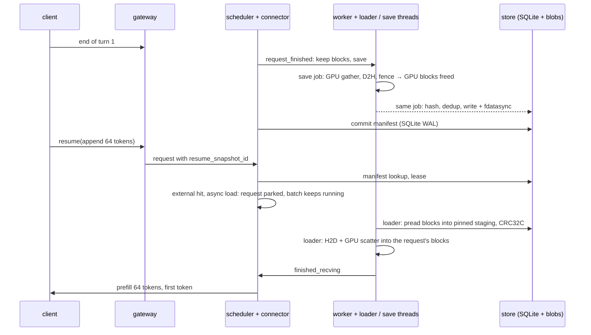

# kvsnap: session KV-cache snapshots for vLLM

kvsnap gives every chat session a **named, fenced snapshot of its KV cache**.
When a turn ends, the session's KV is saved to pinned host memory or to disk
as a snapshot with an id and a generation number. The next turn resumes from
that id: kvsnap copies the blocks into freshly allocated GPU blocks, and vLLM
computes only the new tokens. It is an out-of-tree KV connector for vLLM
0.31.0 (`KVConnectorBase_V1`); vLLM is not modified.

What a named snapshot buys over vLLM's prefix cache and the prefix-hash
offloaders (vLLM's own CPU offloading, LMCache):

- **It survives an engine restart.** Disk snapshots are fdatasync'd,
  checksummed blocks behind an SQLite WAL manifest. After a restart, turn 2
  of an 8k-token Qwen3-8B session starts in 247 ms from the page cache and
  596 ms from a cold disk, against 884 ms to recompute it. Any tier that
  lives in host memory, including kvsnap's own, starts empty. LMCache's
  local-disk backend kept the 7.5 GB it had written, but the restarted
  engine found none of it and recomputed every token (955 ms).
- **A resume gets exactly the saved KV, or misses loudly.** The snapshot is
  matched by id, model identity and tokens, not by whichever prefix blocks
  survived a shared LRU. A generation number fences a stale gateway or a
  late save from a superseded turn, a failed save fails the session's
  `pause` at once, and with batch-invariant kernels a restored turn is
  bit-identical to recompute.
- **Sessions fork.** Blocks are content-addressed, so a fork and the next
  turn share every unchanged block with their parent.

What it does not buy: speed over the alternatives when they apply. With the
session's KV still in GPU memory, vLLM's prefix cache serves turn 2 in
35 ms. Once four 8k sessions have pushed each other out of GPU memory,
LMCache's CPU backend restored them faster than kvsnap's host tier did
(75 vs 121 ms), and vLLM's own CPU offloading came in between (107 ms).
With 16 other requests decoding, LMCache resumed an 8k session in 61 ms and
vLLM's CPU offloading in 112 ms, against 116 ms for kvsnap's default async load;
LMCache paid for it with a p99 decode gap of 58 – 60 ms for the running
requests during resumes, against 18 – 20 ms for kvsnap and 19 – 20 ms for
vLLM's offloading.

**Turn 2 of an 8k-token Qwen3-8B session on one RTX 4090** (median TTFT;
3 runs per cell; turn 2 appends 64 tokens and generates 16; vLLM's default
kernels and CUDA graphs; 2 GiB of GPU KV, about 14k tokens):

| Turn 2 served by | KV still on the GPU | KV evicted from the GPU | After an engine restart |
|---|---|---|---|
| Recompute, prefix caching off | 893 ms | 893 ms | 884 ms |
| vLLM prefix cache | **35 ms** | 899 ms (misses) | misses |
| vLLM CPU offloading (`--kv-offloading-size`) | | 107 ms | starts empty |
| LMCache 0.5.6, CPU backend | | **75 ms** | starts empty |
| LMCache 0.5.6, CPU and local-disk backends | | | 955 ms (finds nothing) |
| kvsnap, host memory | | 121 ms | starts empty |
| kvsnap, disk, page cache warm | | 247 ms | **247 ms** |
| kvsnap, disk, page cache dropped | | 602 ms | 596 ms |

The resident column is `results/baseline-resident-prefix-cache-qwen3-8b.json`.
In the evicted column the three CPU tiers and the prefix-cache miss come from
four 8k sessions rotating through GPU memory
(`results/baseline-evicted-*-qwen3-8b.json`, 36 turns each), and recompute and
kvsnap's disk tiers from `results/restore-qwen3-8b.json`, where nothing stays
on the GPU; kvsnap's host tier measured 118 ms there. kvsnap runs with
prefix caching off, so it has no entry for a KV that is still resident. The
restart column is `results/restart-qwen3-8b.json`, and LMCache's disk row
`results/restart-lmcache-disk-qwen3-8b.json`. Every recompute here runs
with vLLM's prefix caching off.

**These restores are not bit-exact.** With the default kernels used above,
160 of the 180 Qwen3-8B restores in `results/restore-qwen3-8b.json` produced
recompute's 16 greedy tokens, and their logprobs differed from recompute's by
up to 3.5 nats (see [Correctness](#correctness-and-durability)). With
batch-invariant kernels (`VLLM_BATCH_INVARIANT=1`), all 9 Qwen3-8B restores at
8k, three per tier, matched recompute's tokens and logprobs bit for bit, in
130 ms from host memory, 249 ms from a warm disk and 611 ms from a cold one,
against 906 ms to recompute (`results/exact-qwen3-8b.json`, one run).


**While other requests are running** (Qwen3-1.7B, 16 decode streams, 8k-token
sessions resuming one every 2 s; 3 runs of 54 resumes per arm):

| Turn 2 served by | Decode gap of running requests during a resume, p50 / p99 | Turn-2 TTFT, median / p99 |
|---|---|---|
| Recompute (prefill alongside the decodes) | 47.0 – 47.3 / 70 – 71 ms | 265 – 267 / 281 – 295 ms |
| Restore, synchronous load | 7.9 – 8.4 / 97 – 109 ms | 94 / 131 ms |
| **Restore, async load (default)** | **7.6 – 7.7 / 18 – 20 ms** | 116 / 210 ms |
| vLLM CPU offloading, prefix caching on | 9.1 – 9.3 / 19 – 20 ms | 112 / 141 ms |
| LMCache 0.5.6, CPU backend, prefix caching on | 9.5 – 9.6 / 58 – 60 ms | **61** / 78 ms |

Outside resume windows the gap is 7.0 – 7.1 ms at the median and 9 – 11 ms at
p99 on kvsnap's engines (`results/under-load-qwen3-1.7b.json`), and 8.0 –
8.7 ms and 11 – 12 ms on the two offloaders' engines
(`results/under-load-{native-offload,lmcache}-qwen3-1.7b.json`).

## How it works



**Restore.**
1. The scheduler side reports the snapshot's tokens as an external cache hit
   and asks vLLM for an async load. vLLM allocates blocks and parks the
   request.
2. A loader thread either reads each block straight into its slot of one
   pinned buffer and CRC-checks it (disk), or borrows the worker's own pinned
   blocks (host memory).
3. The loader waits for the engine stream's queued work, copies the blocks
   to the GPU and scatters them into place.
4. vLLM then schedules the request and prefills only the suffix.

**Save.**
1. At the end of a turn the connector asks vLLM to keep the request's blocks.
2. A save job gathers them on the GPU and copies them to pinned memory. As
   soon as that copy is fenced, vLLM frees the GPU blocks.
3. The same job hashes, deduplicates and fsyncs. A commit thread on the
   scheduler side then publishes the manifest in one SQLite transaction,
   outside the engine step.

**The data path.** The copy engine is only fast with large copies, and a
snapshot touches `layers × blocks` separate 64 KiB regions. vLLM scatters
block ids in a long-running engine, and the host tier keeps one allocation
per block. So the data plane copies chunks contiguously into a device staging
buffer, then writes each layer's slice with one `index_copy_` on the GPU.
Saves are the mirror image. Measured on 1.2 GB shaped like Qwen3-8B, median
of 3 rounds ([`bench/h2d_patterns.py`](bench/h2d_patterns.py),
`results/h2d-patterns.json`):

| H2D pattern | Consecutive block ids | Shuffled block ids |
|---|---|---|
| Peak: one contiguous copy | 19.1 GB/s | |
| One `cudaMemcpy2DAsync` per (layer, run) | 17.5 GB/s | 12.9 GB/s |
| One copy per (layer, block), from per-block allocations | 13.7 GB/s | 13.7 GB/s |
| **Contiguous chunks + GPU scatter** | **17.1 GB/s** | **17.1 GB/s** |

In the restores below, the copy sustains 16.5 GB/s (1.21 GB in 73 ms, 8B at
8k).

**Failure policy.** Anything that goes wrong before a copy is issued is a
miss, and vLLM recomputes. That covers:
- a mismatched or evicted snapshot;
- a lease that can no longer be taken;
- a bad CRC.

A save that cannot be prepared, including a full pinned pool, is recorded,
and the gateway's `pause` fails at once. Only a copy whose completion cannot
be proven stops the engine. The host-memory tier is an LRU cache: a save
that does not fit evicts the least recently used unleased snapshot.

[docs/design.md](docs/design.md) covers the connector protocol, store
durability and the data plane in detail.

## Results

[`scripts/bench-restore.sh`](scripts/bench-restore.sh) produces every file
in `results/` (see [Reproduce](#reproduce)), and
[`results/README.md`](results/README.md) lists what each one holds. Each
timed configuration ran three times in fresh processes with different seeds;
tables give the median over all samples, with `[min–max]` where shown. The
machine ran other work at the same time (host load averages of 5 – 9 are
recorded with each run).

### Restore against recompute

For each sample, [`bench/restore_ttft.py`](bench/restore_ttft.py) creates a
fresh session:

1. Turn 1 prefills L random tokens.
2. `pause` saves the KV, and vLLM frees the blocks. Prefix caching is off, so
   nothing survives on the GPU: this is a session whose blocks were evicted.
3. Turn 2 appends 64 tokens and generates 16.

Turn 2 is then served one of four ways:
- **recompute:** the full prompt on the same engine, sent directly, with no
  gateway;
- **host:** restored from a host-memory snapshot;
- **disk (warm):** restored from an on-disk snapshot that is still in the
  page cache;
- **disk (cold):** the same snapshot after `posix_fadvise(DONTNEED)`. That
  evicts the page cache only; the NVMe's own cache stays warm.

Each length gets one discarded warm-up per arm. TTFT is measured by the
client, from submitting turn 2 to its first token. Connector telemetry splits
each restore into four phases:
- admission: submit until the scheduler has allocated blocks and taken a
  lease;
- read plus CRC;
- H2D plus scatter;
- the rest: reporting the load, suffix prefill, first token.

**Qwen3-8B**
- 36 layers and 8 KV heads: 144 KiB of KV per token.
- Next to 16 GB of weights, vLLM gets 2 GiB of KV, about 14k tokens.
- `--max-num-batched-tokens 8448`, so even the 8k recompute is one prefill.

| L | Recompute (n=45) | Host | Disk (warm) | Disk (cold) | Host restore: admit / read / H2D / rest |
|---|---|---|---|---|---|
| 1k | 112 [111–115] | 39 [38–43] | 70 [64–82] | 118 [107–136] | 3.1 / 0.8 / 10 / 26 ms |
| 2k | 210 [208–212] | 51 [49–82] | 96 [91–105] | 185 [172–193] | 3.8 / 0.8 / 19 / 27 ms |
| 4k | 418 [416–419] | 73 [71–106] | 142 [130–160] | 327 [314–337] | 5.7 / 0.7 / 37 / 29 ms |
| 8k | 893 [883–924] | 118 [116–142] | 247 [220–319] | 602 [580–640] | 9.4 / 1.0 / 73 / 34 ms |

**Qwen3-1.7B**
- 28 layers and 8 KV heads: 112 KiB per token.
- 6 GiB of KV.

| L | Recompute (n=45) | Host | Disk (warm) | Disk (cold) | Host restore: admit / read / H2D / rest |
|---|---|---|---|---|---|
| 1k | 29 [27–35] | 21 [20–60] | 46 [41–53] | 89 [80–95] | 3.2 / 0.7 / 7.7 / 10 ms |
| 2k | 52 [50–53] | 30 [29–66] | 74 [63–93] | 145 [133–149] | 3.8 / 0.6 / 15 / 11 ms |
| 4k | 103 [100–108] | 49 [47–81] | 109 [97–210] | 255 [246–357] | 5.6 / 0.7 / 29 / 13 ms |
| 8k | 234 [220–241] | 86 [82–105] | 181 [172–199] | 482 [472–531] | 9.0 / 0.9 / 58 / 17 ms |
| 16k | 566 [552–580] | 159 [151–170] | 331 [318–430] | 945 [913–1021] | 17 / 1.4 / 115 / 24 ms |

Times are in ms: median [min–max] of 15 restores (5 per run). Phase columns
are medians of each phase, so they do not sum exactly to the TTFT median.
Each run's median stayed within 6% of the pooled one, except three
Qwen3-1.7B cells at 1k and 4k (up to 14%); `ttft_ms_median_by_run` has them
all.

What the numbers show:

- **The win depends on compute per byte of KV.**
  - Prefilling 8k tokens takes 3.8× longer on 8B than on 1.7B (893 vs
    234 ms), but 8B has only 1.3× the KV per token.
  - On 8B, host and warm-disk restores win at every length. A cold restore
    loses slightly at 1k and wins from 2k.
  - On 1.7B, a host restore wins at every length, 3.6× at 16k. A warm disk
    restore still loses at 4k and wins from 8k.
- **The restore is mostly H2D.**
  - H2D grows linearly with L, at about 16.5 GB/s.
  - Admission takes 3–9 ms for host restores on 8B (17 ms at 16k on 1.7B):
    the gateway's generation claim, one manifest lookup on each side and
    the lease. Disk restores take 14–35 ms; their turns fsync the
    generation claim.
  - The rest, 10–34 ms, is reporting the load, the suffix prefill and the
    first token.
- **A cold disk restore is limited by reads.** At 8k on 8B, reading
  1.2 GB takes 468 ms (about 2.6 GB/s) with 8 `pread`s in flight. Reads and
  copies are not overlapped.
- **Saving is slower than restoring.** `pause` returns once the snapshot is
  committed: 2.2 s for a durable 8k snapshot on 8B, 0.26 s for host memory
  (`save_ms`).

### Against prefix caching and other offloaders

[`bench/resume_baselines.py`](bench/resume_baselines.py) serves the resumed
turn on otherwise identical Qwen3-8B engines (2 GiB of GPU KV, synchronous
scheduling, default kernels):

- **Resident:** turn 2 follows turn 1 at once, so with prefix caching on its
  KV is still on the GPU. vLLM reports all of turn 1's prompt tokens as
  cached.
- **Evicted:** four 8k-token sessions (33k tokens of KV) take turn 1 in
  order, then three more turns each in the same order, so each session comes
  back after the others pushed its blocks out. vLLM's CPU offloading and
  LMCache each get 8 GiB of CPU memory, enough for all four sessions;
  kvsnap's host tier gets 6 GiB.

| L | Prefix cache, resident | Recompute |
|---|---|---|
| 1k | 25 [24–26] | 112 |
| 2k | 26 [26–27] | 210 |
| 4k | 29 [28–30] | 418 |
| 8k | 35 [34–39] | 893 |

| Evicted, 8k, n=36 | TTFT | Prompt tokens vLLM did not recompute |
|---|---|---|
| vLLM prefix cache alone | 899 [888–908] | 0 of 8337 |
| vLLM CPU offloading | 107 [102–173] | 8256 |
| LMCache, CPU backend | **75** [71–85] | 8192 |
| kvsnap, host memory | 121 [115–171] | (restored by kvsnap) |

LMCache needs its own environment: version 0.5.6 pins older numpy, protobuf
and OpenTelemetry than a plain vLLM 0.31.0 install picks, and
`scripts/install.sh lmcache` resolves them together. Neither offloader keeps
its CPU copy across an engine restart, and LMCache finds none of its disk
backend's files after one (see
[Resume after an engine restart](#resume-after-an-engine-restart)).

### Interference with running requests

[`bench/restore_under_load.py`](bench/restore_under_load.py):
- Qwen3-1.7B;
- 16 decode streams, each running 1,000-token greedy requests back to back
  (128-token prompts);
- six sessions with 8k-token host snapshots, resuming round robin, one
  every 2 s, until 54 resumes are measured (one more is a discarded
  warm-up);
- `--max-num-batched-tokens 2048`.

| Turn 2 served by | Decode gap during a resume: p50 / p99 | Turn-2 TTFT: median / p99 / max |
|---|---|---|
| Recompute (chunked 8k prefill in the batch) | 47.0 – 47.3 / 70 – 71 ms | 265 – 267 / 281 – 295 / 289 – 337 ms |
| Restore, load inside `start_load_kv` (sync) | 7.9 – 8.4 / 97 – 109 ms | 94 / 131 / 132 ms |
| Restore, loader thread (async) | 7.6 – 7.7 / 18 – 20 ms | 116 / 210 / 284 ms |
| vLLM CPU offloading (`--engines native-offload`) | 9.1 – 9.3 / 19 – 20 ms | 112 / 141 / 176 ms |
| LMCache, CPU backend (`--engines lmcache`) | 9.5 – 9.6 / 58 – 60 ms | 61 / 78 / 81 ms |

Decode-gap ranges are over the three runs (each has 2,900 – 13,300 gaps
during resumes). TTFT pools the 162 resumes of each arm; recompute ran on
both kvsnap engines. The offloader arms run one engine without kvsnap, with
prefix caching and that offloader on (14 GiB of CPU memory), and send each
turn's whole prompt to it. On every resume vLLM computed none of the
session's 8,192 tokens (`num_cached_tokens` is at least 8192).

- **Recompute** sends the whole prompt straight to the engine and puts 8k
  tokens of prefill into the batch, which slows every running request.
- **A synchronous load** stalls the whole batch for the copy: that is its
  tail.
- **The async load** leaves the median decode gap at its baseline. It costs
  the restored request one engine step to be reported: its TTFT median is
  22 ms above the synchronous load's.
- **LMCache resumes fastest** (61 ms median, 55 ms sooner than the async
  load), but its p99 decode gap during resumes is 58 – 60 ms, against
  18 – 20 ms for the async load and 97 – 109 ms for the synchronous one.
- **vLLM's CPU offloading** keeps the p99 gap at 19 – 20 ms, next to the
  async load's 18 – 20 ms, and resumes 5 ms sooner (112 ms).
- **Both offloaders' engines decode more slowly outside resumes too:** their
  median gap there is 8.0 – 8.7 ms, against 7.0 – 7.1 ms on kvsnap's
  engines, so their during-resume medians start from a higher baseline.

### Turn-end stalls

A traced run of this code (`bench/restore_under_load.py --trace-dir`,
summarized by [`bench/trace_summary.py`](bench/trace_summary.py) in
`results/turn-end-trace.json`) shows what a save costs the running batch.
Of the 54 turn ends with an async load, 6 had one or two engine steps
longer than 20 ms (7 steps of 22 – 44 ms, against about 7 ms for a normal
step), and the rest had none. The save itself runs beside the engine: D2H 66 ms, hashing and
preparation 127 ms and the commit 23 ms at the median, while
`request_finished` holds the scheduler for 0.5 ms. The client's event loop
never stopped for more than 42 ms, and no collection took over 5 ms.

An earlier design committed each save inside the engine step. There, decode
gaps outside resume windows reached 90 – 246 ms (`results/turn-end-stalls.json`,
`before`), and traces of it and of each change that removed the stalls are
in `results/turn-end-traces.json` (see `results/README.md`):

| Stall in the earlier design | Cause | Fix |
|---|---|---|
| At every turn end one engine step took 71–114 ms | `commit_prepared` ran inside the engine step, 29–105 ms per save: an ownership round trip for every block already committed, deep copies of a manifest that holds every token, and that manifest validated three times | A commit thread publishes saves in order; one round trip per owner; shallow copies; one validation |
| The client's event loop stopped for up to 197 ms, delaying every stream's tokens | Every store read took the cross-process writer lock, so the gateway's snapshot polling waited out the engine's commits; the generation claim's fsync ran on the loop | Reads take no writer lock; store calls run on worker threads |
| One 157 ms stall of every stream | A full garbage collection in the gateway process walked the vLLM client, tokenizer and model config | `gc.freeze()` once the engine is up, as vLLM does in its engine process |

### Resume after an engine restart

[`bench/restart_resume.py`](bench/restart_resume.py) runs on Qwen3-8B:
1. Sessions are saved durably.
2. The engine is shut down, and a new engine starts on the same store.
   Startup takes 19 s.
3. The gateway recovers each session from its manifest and resumes it.
4. Once the resumed turn's own durable save has finished, the same prompt is
   recomputed on the new engine (prefix caching off).

Six sessions per cell, two per run:

| L | Restore, page cache warm | Restore, page cache dropped | Recompute on the new engine |
|---|---|---|---|
| 2k | 95 [92–102] ms | 189 [183–242] ms | 210 [209–211] ms |
| 8k | 247 [233–315] ms | 596 [593–598] ms | 884 [881–887] ms |

**LMCache's local-disk backend across the same restart**
(`--engine lmcache-disk`, `results/restart-lmcache-disk-qwen3-8b.json`, 3 runs
of four sessions per length). An engine without kvsnap, with prefix caching
on and LMCache's CPU (8 GiB) and local-disk (40 GiB) backends, prefills each
session. Once the disk directory stops growing, at 7.5 GB in every run, a new
engine starts on the same directory (11 s) and is sent each session's turn-2
prompt whole. It recovered nothing: vLLM reported 0 cached prompt tokens on
all 24 resumes, and turn 2 took a full prefill, 234 [225–238] ms at 2k and
955 [946–961] ms at 8k. LMCache 0.5.6 keeps its index of the disk backend's
files in process memory (`LocalDiskBackend` starts with an empty one and
does not scan the directory), so a new engine's lookups miss even though
the files are still there.

### Store scaling

[`bench/store_stress.py`](bench/store_stress.py) fills a store with 500
sessions and times what a turn does to it, on the store before and after its
scaling changes, back to back (`results/store-stress.json`; 64 blocks per
snapshot, half of them in host memory; medians of 5):

| Operation, 500 sessions | Before | After |
|---|---|---|
| Invalidate a host-memory snapshot (also how the host tier evicts) | 40.7 s | 0.9 ms |
| Invalidate a disk snapshot | 38.6 s | 10.0 ms |
| Turn-end room check in the host tier, room left | 25.6 ms | under 0.01 ms |
| Save a snapshot at the `process` level (admission, writes, commit) | 128 ms | 47 ms |
| Manifest lookup while another thread commits, worst of 10 s | 42.5 ms | 3.0 ms |

Before, every invalidation rebuilt every reference count with an unindexed
query inside a `synchronous=FULL` transaction, every disk save stat-ed every
blob file under the exclusive blob lock, and reads shared the writer's
connection. With 512 blocks per snapshot (8k tokens), an invalidation takes
26 ms and a forced eviction 0.7 s, because finding out how full the host tier
is still walks every host block (see [Limitations](#limitations)).

## Correctness and durability

- **Bit-exact restore, with a negative control.**
  - With batch-invariant kernels (`VLLM_BATCH_INVARIANT=1`), the restored
    turn's 16 logprobs equal recompute's bit for bit. This held for all 18
    restores on Qwen3-1.7B (2k and 8k, all three tiers, CUDA graphs on;
    `results/exact-qwen3-1.7b.json`) and all 9 on Qwen3-8B (8k, all three
    tiers; `results/exact-qwen3-8b.json`).
  - The control flips the sign of one head's key vector for one token in
    each disk snapshot, with checksums fixed so the load accepts it. Then
    all 12 disk restores' logprobs differ, while 11 of 12 still produce the
    same greedy tokens (`results/exact-perturbed-qwen3-1.7b.json`).
    Comparing tokens alone would not have caught it.
  - With vLLM's default kernels, prefilling a 64-token suffix and prefilling
    the whole prompt are different floating-point computations. Logprobs
    then differ by up to 3.5 nats, and greedy tokens matched in 368 of 405
    restores: 160 of 180 on Qwen3-8B and 208 of 225 on Qwen3-1.7B
    (`results/restore-*.json`). A prefix-cache hit prefills the same suffix, and so differs
    from a full prefill in the same way.
- **Crash safety.**
  - `tests/crash` SIGKILLs a real writer process at eight boundaries of a
    store commit, for both the process and durable levels: after D2H,
    during the blob write, before fdatasync, after rename, before and after
    the manifest commit, before GPU release, and during H2D.
  - `recover()` then rejects every interrupted snapshot and keeps every
    committed one.
  - These are store-level failpoints, not interrupted CUDA copies, and none
    of this tests power loss. The connector's prepare → commit path uses
    the same blob writer and publish transaction, but is not killed at its
    own points.
- **Fencing.** Each session has a generation number in SQLite. A stale
  gateway, or a late save from a superseded turn, cannot overwrite a newer
  snapshot. Restores take a lease that keeps GC and host-tier eviction away
  while the blobs are read.
- **Data plane.**
  - The C++ pool copies on its own non-blocking stream.
  - Every copy waits for the engine stream's queued work first.
  - Nothing is released until its CUDA event completes.
  - An unprovable completion keeps the memory.
  - Tests compile the pool against a fault-injecting fake CUDA runtime.

`pytest` runs 169 tests on CPU, covering:
- the store, crash recovery, host-tier eviction and the store's reference
  counts and disk accounting;
- the gateway, and its HTTP server over a loopback socket;
- the connector's control flow and failure policy;
- the native data plane, against the fake CUDA runtime;
- block-layout geometry;
- the GPU gather and scatter that every save and restore runs, on CPU
  tensors laid out as vLLM registers Qwen3-8B's KV cache (these 5 need
  torch, CPU-only is enough, and are skipped without it).

GitHub Actions runs them, and the native library's own test, on every push
(`.github/workflows/cpu-tests.yml`).

## Reproduce

**Hardware.** Every number here comes from one machine: an RTX 4090 (24 GB,
PCIe 4.0 x16, driver 595.99.02), an i9-13900K with 123 GiB of RAM, and a
Samsung 980 PRO NVMe holding the snapshot store. Every results file records
the GPU, driver, clocks, PCIe link, host load average and git commit of each
run under `environment`. The machine ran other work at the same time, which
the load averages show. Each benchmark process held the GPU lock that the
machine's GPU jobs share, and about 0.7 GB of GPU memory was in use by other
processes when each run started.

```sh
scripts/install.sh cpu                 # .venv: the package and the CPU tests
.venv/bin/python -m pytest             # 169 tests, no GPU; .venv has no torch, so 5 skip
scripts/install.sh gpu                 # .venv-gpu: vLLM 0.31.0, torch 2.13.0 (CUDA 13.0), the pinned pool
scripts/install.sh lmcache             # optional .venv-lmcache: LMCache 0.5.6 for its baseline
scripts/download-models.sh             # Qwen3-1.7B and Qwen3-8B at the pinned revisions, about 20 GB
scripts/bench-restore.sh smoke         # one short sample of each benchmark
scripts/bench-restore.sh               # everything in Results: over two hours of GPU time
```

`bench-restore.sh` runs each timed configuration three times in fresh
processes with different seeds and merges the runs into `results/*.json`
(per-run files go to `results/raw/`, which is not committed). It reads the
models from the Hugging Face cache offline; `KVSNAP_MODEL_8B` can point at a
local Qwen3-8B snapshot directory instead. Snapshot stores go to
`KVSNAP_BENCH_STORE` (default `.local-data/tmp`), which should be on an SSD.
Each benchmark process takes `flock /var/tmp/rtx4090.lock` while it runs, so
it can share a GPU with other jobs that use the same lock.

## Repository layout

| Path | What it is |
|---|---|
| `kvsnap/connector/vllm.py` | the vLLM KV connector: scheduler side, worker side, save and load jobs |
| `kvsnap/connector/dataplane.py` | pinned pool bindings, GPU gather/scatter, KV layout checks |
| `kvsnap/connector/volatile.py` | host-memory (pinned) snapshot tier owned by the worker |
| `kvsnap/connector/engine.py` | `AsyncLLM` adapter used by the gateway; `create_async_llm` |
| `kvsnap/store/` | `store.py`: SQLite WAL manifests, commits, leases; `blobs.py`: blob files; `volatile_tier.py`: host-memory snapshots and eviction; `maintenance.py`: invalidation, recovery, fork, GC |
| `kvsnap/gateway/` | session API: create, turn, pause, resume, fork, close (Python and HTTP) |
| `csrc/dataplane/` | C++ pinned pool (`cudaHostAlloc`, copy stream, events) and file I/O with SSE4.2 CRC32C |
| `bench/` | the benchmarks above, the trace summary, the store stress test and the plot |
| `results/` | benchmark results ([`results/README.md`](results/README.md)) |
| `scripts/` | installation, model download and the benchmark suite |

## Limitations

- **Scope.** The connector is pinned to vLLM 0.31.0, TP=1, one full-attention
  KV group and synchronous scheduling. It was measured with vLLM's prefix
  caching off.
- **Turn boundaries only.** A snapshot is taken at the end of a turn.
  Pausing mid-generation is not supported.
- **The bundled server is stricter than the benchmarks.**
  `kvsnap serve --engine vllm` refuses to start unless
  `VLLM_BATCH_INVARIANT=1` is set, and accepts only greedy decoding. The
  headline numbers use vLLM's default kernels: the benchmarks drive the
  engine adapter directly with that check turned off. The API takes token
  IDs only; there is no tokenizer or chat template in front of it.
- **Slower than LMCache from host memory.** In the rotation above, LMCache's
  CPU backend restored an 8k session 46 ms sooner than kvsnap's host tier.
  Under load it resumed 55 ms sooner than kvsnap's async load, at a higher
  p99 decode gap for the running requests.
  kvsnap's restore is mostly a 73 ms H2D copy plus an engine step to report
  the load, and nothing overlaps the copy with the prefill; LMCache's own
  phases were not measured.
- **Turn-end saves still cost the batch a little.** In the trace above, 6 of
  54 turn ends had engine steps of 22–44 ms instead of about 7 ms: the
  save thread's gather and D2H share the GPU with the decode kernels, and
  its hashing and bookkeeping share the GIL with the engine thread.
- **Scheduler-side bookkeeping runs inside the engine step.** Matching a
  resume, taking its lease and evicting host snapshots run on the scheduler
  thread. The lease and an eviction are writes, so they wait for a commit in
  flight. An eviction measures the host tier, which walks every host block.
- **Durable saves are slow.** `pause` on an 8k-token Qwen3-8B session
  returns after about 2.2 s for a disk snapshot, against about 0.26 s for
  host memory.
- **Disk restores** read every block before the first copy.
- **Saves rehash every block** to deduplicate. Unchanged blocks are not
  rewritten, but they are hashed again.
- **Unreferenced blobs stay on disk** until something calls
  `collect_garbage()`; the serving path does not.
- **Evaluation.** One GPU, two models, random token prompts, at most four
  rotating sessions for the eviction workload, and no multi-turn traces from
  real conversations.
